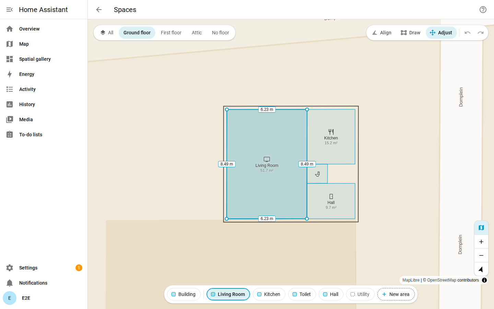
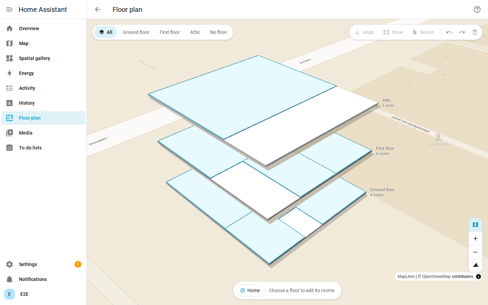
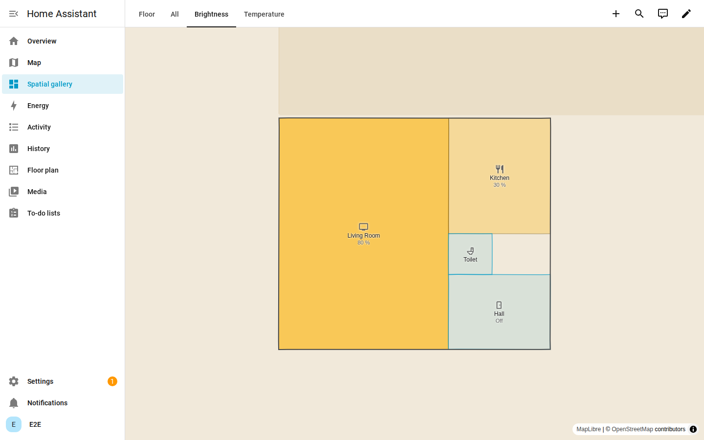
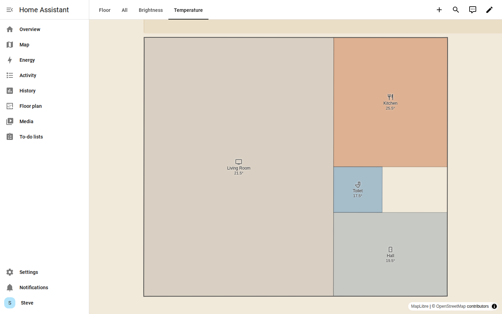

# Spatial

[-add%20from%20link-41BDF5.svg)](https://github.com/BIM-Tools/ha-spatial#install)
[](https://github.com/BIM-Tools/ha-spatial/releases)

Room footprints for Home Assistant areas, drawn on Home Assistant's own map.

Home Assistant knows your floors and areas, but not where they are. Spatial is a small
extension to that data model: each area gets a footprint and each floor a height, on the same map
as your zones, and Spatial works out how big each room is and which rooms touch. That is
all: no walls, no furniture, no 3D modelling.



## What it does

| Home Assistant has | Spatial adds |
| --- | --- |
| Home location, zones | The building outline and the direction of its walls |
| Floors | Elevation and height |
| Areas | A footprint on the wall axes, so neighbouring rooms share their edges |

With a height per floor, **All** stacks the floors above the map, seen from the front corner of
the house: 3D in its simplest form.



- **Derived.** Sizes and neighbours are computed; areas and floors stay Home Assistant's.
- **A floor plan card.** One floor or all floors stacked. On one floor, rooms can be coloured
  by light or temperature.
- **Local.** Stored in `.storage/spatial`, included in every backup.
- **API.** Rooms as JSON-FG polygons over a versioned
  [websocket API](https://github.com/BIM-Tools/ha-spatial/blob/main/custom_components/spatial/README.md#websocket-api); tools can ask which room
  a point lies in.

| `colour_by: brightness` | `colour_by: temperature` |
| --- | --- |
|  |  |

## Install

Spatial installs from the new **Marketplace**: HACS, built into Home Assistant since 2026.11.

1. Open **Settings › Marketplace**, choose **Add from link**, paste
   `https://github.com/BIM-Tools/ha-spatial`, press **Add** and install Spatial from the page
   that opens.
2. Restart Home Assistant.
3. Open **Settings › Devices & services › Add integration**, search for **Spatial** (or use
   the button below) and press **Open floor plan** in the last step. Later, **Floor plan** is in
   the sidebar.

   [](https://my.home-assistant.io/redirect/config_flow_start/?domain=spatial)

Needs Home Assistant 2026.11 or newer. Like every Marketplace project, Spatial is a community
project, not tested or supported by the Home Assistant project.

<details>
<summary>Install by hand</summary>

Download `spatial.zip` from the [latest release](https://github.com/BIM-Tools/ha-spatial/releases),
unzip it into `config/custom_components/spatial/`, restart Home Assistant and continue with
step 3. Use the release zip, not a copy of this repository: the panel and card are built into
the zip and are not in git.

</details>

## Draw your home

> **Before you start:** you need areas, and the areas need floors (**Settings › Areas, labels &
> zones**). An area without a floor lands under **No floor**.

Open **Floor plan** in the sidebar. A line at the top says what to do next, and the one
button to press is lit.

1. **Find your home.** Type your address and press **Search**.
2. **Align.** Click the front wall of your house. The map turns so that wall lies flat, and
   the boxes you draw follow your walls.
3. **Outline.** Use the map's outline of your house, or draw it yourself. Then check one length
   you know, such as the front of the house: click the length and type the real one.
4. **Rooms.** Drag a box for each room; the next room to draw is picked for you. For an
   L-shaped room, drag a second box against the first.

Everything saves as you go, and you can undo every step. The [user guide](https://github.com/BIM-Tools/ha-spatial/blob/main/docs/user-guide.md)
walks through every step.

## Put it on a dashboard

Edit a dashboard, choose **Add card** and pick **Spatial map**: your rooms with floor buttons.
To fix it to one floor and colour its rooms, open the code editor (`floor` is a floor id):

```yaml
type: custom:spatial-map-card
floor: ground_floor     # one floor, or "all" to stack every floor
colour_by: brightness   # or temperature (one floor only)
```

All options are in the [user guide](https://github.com/BIM-Tools/ha-spatial/blob/main/docs/user-guide.md#dashboard-card).

## Privacy

Your plan never leaves Home Assistant. Only an address search does, when you press **Search**.
It goes to [OpenStreetMap Nominatim](https://nominatim.org/), the same service Home Assistant
uses to find your home during setup, and Spatial keeps nothing. To use your own server, set
**Address search server** under **Settings › Devices & services › Spatial › Configure**.

<details>
<summary>What an address search sends</summary>

- When: only when an administrator presses **Search**. Nothing is searched automatically or
  while typing.
- What: the typed text, Home Assistant's language, and an area of about 50 km around Home
  Assistant's home location rounded to 0.1 degree (so nearby places come first), with a user
  agent naming this integration. Nominatim also sees your IP address; see the
  [OSMF privacy policy](https://osmfoundation.org/wiki/Privacy_Policy).
- Kept: nothing. The text and the results are not logged or stored by the integration. Home
  Assistant's own websocket debug logging, when you switch it on, records every message,
  searches included.

</details>

## Remove

1. **Settings › Devices & services › Spatial › ⋮ › Delete.**
2. In **Settings › Marketplace › Installed**, open Spatial's **⋮** menu, choose **Uninstall**
   and restart Home Assistant.
3. For a clean slate, delete `.storage/spatial` too.

## Help and feedback

Spatial is young: the storage format can still change. Undo does not survive a reload; see
[Known limits](https://github.com/BIM-Tools/ha-spatial/blob/main/docs/user-guide.md#known-limits).

Ideas, questions and bugs are very welcome in
[GitHub issues](https://github.com/BIM-Tools/ha-spatial/issues).

## For developers

Based on the [BOT ontology](https://w3id.org/bot): footprints are JSON-FG features of type
`bot:Space`. Pure Python, no extra packages. Bridges to things like IFC and CityJSON
can be built outside Home Assistant on the websocket API.

| Document | For |
| --- | --- |
| [Architecture](https://github.com/BIM-Tools/ha-spatial/blob/main/docs/architecture.md) | How the parts fit together, repository layout, development |
| [Integration](https://github.com/BIM-Tools/ha-spatial/blob/main/custom_components/spatial/README.md) | Websocket API, storage and geometry rules, for tool and bridge builders |
| [Frontend](https://github.com/BIM-Tools/ha-spatial/blob/main/frontend/README.md) | Panel and card source, build and serving |
| [Tools](https://github.com/BIM-Tools/ha-spatial/blob/main/tools/README.md) | GeoJSON importer, example house, version sync |

Contributing: read [AGENTS.md](https://github.com/BIM-Tools/ha-spatial/blob/main/AGENTS.md) first; it applies to people and coding agents alike.
You are responsible for every line you submit, however it was written
([Home Assistant AI policy](https://developers.home-assistant.io/docs/ai_policy)).

## License

[MIT](https://github.com/BIM-Tools/ha-spatial/blob/main/LICENSE)
