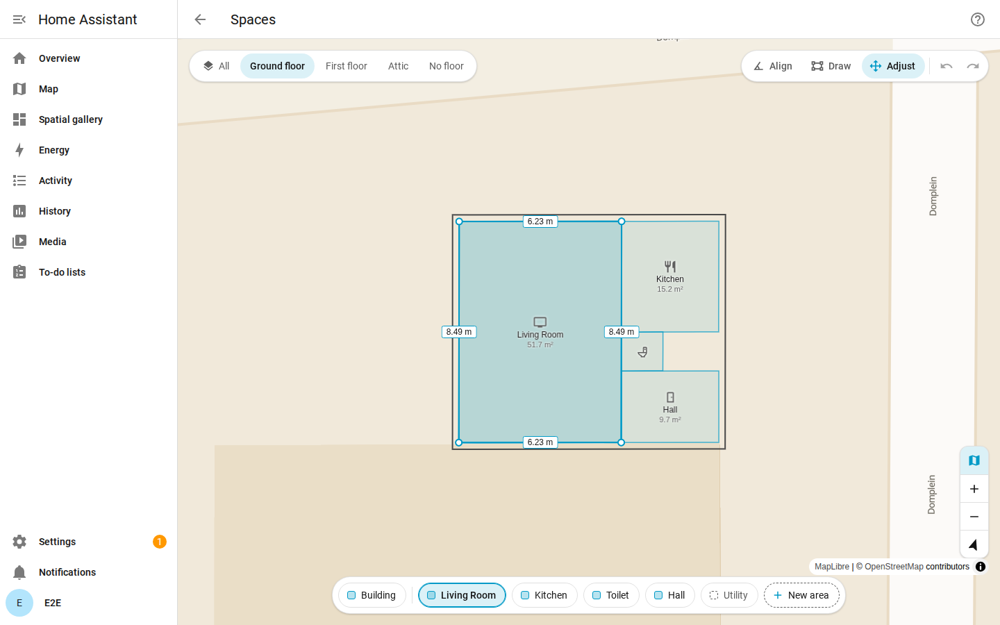
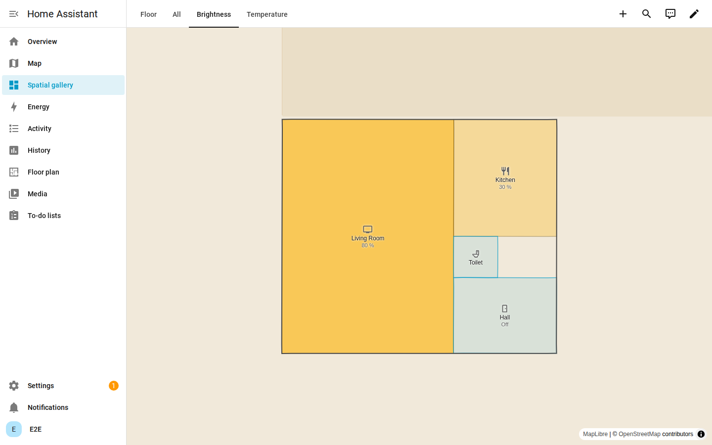
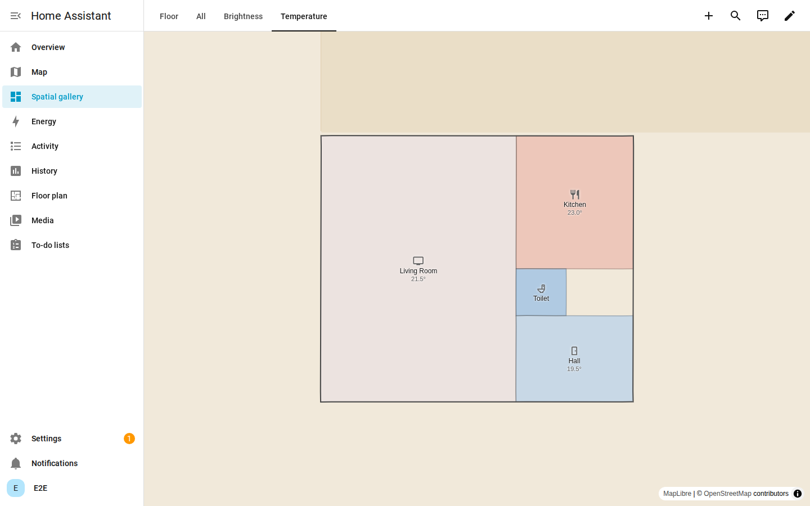

# Spatial

Room footprints for Home Assistant areas, on the same map as your zones.



## Why

- Home Assistant knows your floors and areas, but not where they are or which rooms touch.
- Spatial adds an optional footprint per area and a height per floor, drawn on Home Assistant's
  own map in a few clicks.
- Net room areas and neighbouring rooms follow from the footprints; nothing extra to maintain.
- Small: pure Python, no extra dependencies, Home Assistant's own map and theme; the data
  stays in Home Assistant.
- Not a CAD tool or a tracker: no walls, doors, furniture or device positions. Positioning
  projects can ask which room a point lies in through the websocket API.

Early version: the storage format can still change; the websocket API is versioned
(`api_version`, see the [integration README](custom_components/spatial/README.md#compatibility)).

## Install

HACS installs `spatial.zip` from a published GitHub release. The panel and card are built
into that zip and are not in git, so copying the source folder gives no editor.

1. In HACS, open the three-dot menu > Custom repositories and add
   `https://github.com/BIM-Tools/ha-spatial` with type Integration.
2. Download Spatial (Home Assistant 2026.10.0 or newer).
3. Restart Home Assistant, then Settings > Devices & services > Add integration > Spatial.

Without HACS: download `spatial.zip` from the
[releases page](https://github.com/BIM-Tools/ha-spatial/releases), unzip it into
`config/custom_components/spatial/`, then continue with step 3.

## Room colours

A dashboard card fixed to one floor can colour its rooms by live data and write the value under
each room's name. `brightness` reads the brightest light that is on in the area, `temperature`
the average of its temperature sensors.

```yaml
type: custom:spatial-map-card
floor: ground_floor
colour_by: brightness
```



```yaml
type: custom:spatial-map-card
floor: ground_floor
colour_by: temperature
```



## Privacy

Your footprints, floors and site stay in Home Assistant. One thing leaves it: an address
search.

- When: only when an administrator searches for an address explicitly. Nothing is searched
  automatically or while typing.
- What: the typed text, Home Assistant's language, and an area of about 50 km around Home
  Assistant's home location rounded to 0.1 degree (so nearby places come first), sent to
  [OpenStreetMap Nominatim](https://nominatim.org/) with a user agent naming this integration.
  Nominatim also sees your IP address; see the
  [OSMF privacy policy](https://osmfoundation.org/wiki/Privacy_Policy). To use your own
  Nominatim server instead, set **Address search server** under Settings > Devices & services >
  Spatial > **Configure**.
- Kept: nothing. The text and the results are not logged or stored by the integration. Home
  Assistant's own websocket debug logging, when you switch it on, records every message,
  searches included.

## Documentation

| Document | For |
| --- | --- |
| [User guide](docs/user-guide.md) | Drawing your house, the panel and the dashboard card |
| [Architecture](docs/architecture.md) | Developers: how the parts fit together, repository layout, development |
| [Integration](custom_components/spatial/README.md) | Websocket API, storage and geometry rules |
| [Frontend](frontend/README.md) | Panel and card source, build and serving |
| [Tools](tools/README.md) | GeoJSON importer, example house, version sync |

## Contributing

- Read [AGENTS.md](AGENTS.md) first; it applies to people and coding agents alike.
- You are responsible for every line you submit, however it was written
  ([Home Assistant AI policy](https://developers.home-assistant.io/docs/ai_policy)).

## License

MIT
