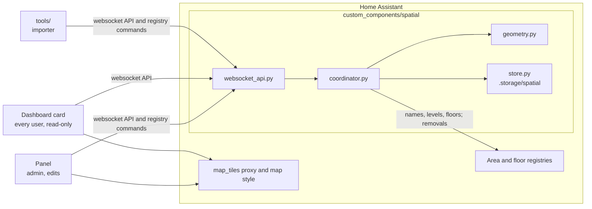

# Architecture

For developers. How to use Spatial is in the [user guide](user-guide.md); the rules for changing
it are in [AGENTS.md](../AGENTS.md).

## Parts

| Part | Role |
| --- | --- |
| Home Assistant registries | Own areas and floors: ids, names, icons, levels, floor assignment |
| Integration | Stores footprints, room properties, floor heights and the site; computes areas, neighbours, facade and outdoor flags and point lookups; the only API |
| Panel | The admin-only editor: Align, Draw, Adjust, undo and redo, saving each action at once |
| Card | The same map on a dashboard, read-only, for every user |
| Tools | Import GeoJSON over the websocket API; keep frontend package versions in step |

- The panel and the card are one bundle: the card embeds the panel element without its tools.
- Tools, bridges and frontends use only the websocket API; nothing else reads `.storage/spatial`.

## Data model

| Object | Keyed by | Stored | Computed on read |
| --- | --- | --- | --- |
| Area | `area_id` | `polygon` (GeoJSON Polygon, WGS84), `floors_up`, `on_facade_override` | `area_m2` (net), `floor_ids`, `base_m`, `top_m`, `on_facade`, `is_external`, `rev`; name, floor and level from the registries |
| Floor | `floor_id` | `elevation_m`, `height_m` (both optional) | Without them, 3 m per level |
| Site | one per installation | `bearing_deg` (null until the first Align), `origin` (grid origin or null), `outline` (Polygon or null) | Centre: the footprints' bounding box, else the outline, else the home location; `rev` |

- Every area entry and the site carry a `rev`, a hash of their content; writes may send the rev
  they expect and are refused with `conflict` when it changed.
- Deleting an area or floor in Home Assistant deletes its spatial data.
- The concepts follow the W3C Building Topology Ontology (BOT); the feed marks each footprint as
  `bot:Space` and conforms to JSON-FG.

## Design rules

The full list of settled decisions is in [AGENTS.md](../AGENTS.md#settled-decisions); these are
the ones the code applies today.

| Rule | Value |
| --- | --- |
| Coordinates | WGS84 GeoJSON, the same world as Home Assistant zones |
| Measurement | In the integration, local tangent plane with exact WGS84 radii; never from the map projection |
| Footprint | One area has at most one `Polygon`, holes allowed; no MultiPolygon |
| Drawing convention | Rooms are drawn to wall centrelines, so neighbours share edges; the outline is the facade |
| Rooms across floors | The Home Assistant floor is a room's lowest; `floors_up` adds the floors above it |
| Adjacency | Derived from shared edges, outer and inner rings, on every floor both rooms occupy; never stored |
| Area | `area_m2` is net: the drawn polygon shrunk by 50 mm on every side |
| Outdoor, facade | `is_external`: more than half the room outside the outline; `on_facade`: an edge on the outline, with an optional override |
| Building, sub-spaces | Home Assistant labels; no code |
| Site anchor | One direction and one optional outline per installation; aligns views only, stored geometry never moves with it |
| Finding the building | OSM buildings in Home Assistant's map tiles set the direction only |
| Dependencies | Pure Python in the integration; turf and MapLibre in the frontend |
| Frontend packages | Packages shared with Home Assistant's frontend use the exact version it ships |

## Websocket API

| Command | For |
| --- | --- |
| `spatial/geojson` | All footprints as a FeatureCollection, optionally of one floor |
| `spatial/site` | Centre, direction, grid origin, outline and rev |
| `spatial/query_point` | The area at a coordinate |
| `spatial/area/adjacent` | The neighbours of an area |
| `spatial/subscribe` | An event on every change |
| `spatial/area/update_geometries` | Footprints, room properties and the site in one change (admin) |
| `spatial/floor/update` | Floor elevation and height (admin) |
| `spatial/site/update` | Direction, grid origin and outline (admin) |

Inputs, results and errors: [integration README](../custom_components/spatial/README.md#websocket-api).

## Repository layout

| Path | Content |
| --- | --- |
| `custom_components/spatial/` | The integration ([README](../custom_components/spatial/README.md)) |
| `frontend/` | Panel and card source, built into the integration ([README](../frontend/README.md)) |
| `tests/` | Integration tests against a real Home Assistant |
| `e2e/` | Browser scripts: the smoke test and the state gallery, which also renders the documentation images |
| `tools/` | GeoJSON importer, example house, version sync ([README](../tools/README.md)) |
| `docs/` | This page, the user guide and their images |

## Development

Home Assistant runs on Linux only, so everything runs in Docker; a VS Code devcontainer is
included. All commands are in [AGENTS.md](../AGENTS.md#commands).

| Task | Command |
| --- | --- |
| Tests | `docker compose run --rm test` |
| Panel build, rebuilt on change | `docker compose up -d frontend` |
| Home Assistant with your changes | `docker compose up homeassistant`, then <http://localhost:8123> |
| Example house | Import `tools/example_house.geojson`, see [tools](../tools/README.md) |
| State gallery and documentation images | `docker compose run --rm gallery; docker compose rm -sf homeassistant-e2e` |

- The Home Assistant version tested against is pinned in `requirements_test.txt`.
- The built panel is not in git; HACS installs it from the release zip that
  `.github/workflows/release.yml` builds.
