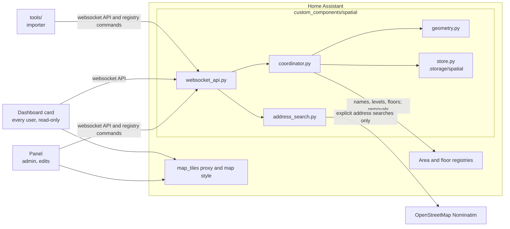

# Architecture

For developers: how the parts fit together. How to use Spatial is in the
[user guide](user-guide.md); the rules for changing it, the settled decisions and all commands
are in [AGENTS.md](../AGENTS.md).

## At a glance

| What | How |
| --- | --- |
| Stored | Per area: at most one footprint (a GeoJSON Polygon in WGS84, holes allowed), `floors_up` and an optional facade override. Per floor: elevation and height. Per installation: one site with origin, bearing and building outline |
| Read, never copied | Area and floor ids, names, icons, levels and floor assignment, from Home Assistant's registries |
| Derived on every read | Net area, neighbouring rooms (shared walls, on each floor a room occupies), outdoor (outside the outline), on the facade, the room a point lies in |
| Coordinates | WGS84, the world of Home Assistant's zones and map; measured in one local frame at the site origin, on a 2.5 cm (1 in) lattice so shared walls compare exactly |
| Contract | The `spatial/*` websocket commands, versioned by `api_version` in `spatial/site` ([Compatibility](../custom_components/spatial/README.md#compatibility)) |
| Not in scope | Walls, doors, furniture, device positions, tracking, CAD or BIM files inside Home Assistant; bridges for those run outside and use the websocket API |

## Parts

| Part | Role | Reference |
| --- | --- | --- |
| Home Assistant registries | Own areas and floors: ids, names, icons, levels, floor assignment | |
| Integration | Stores footprints, room properties, floor heights and the site; computes areas, neighbours, facade and outdoor flags and point lookups; the only API | [Integration README](../custom_components/spatial/README.md): data, websocket API, geometry rules, modules |
| Panel | The admin-only editor, saving each action at once | [Frontend README](../frontend/README.md): files, serving, the commands each action sends |
| Card | The same map on a dashboard, read-only, for every user; optionally colours rooms from the areas' lights or temperature sensors in Home Assistant's states | [Frontend README](../frontend/README.md#serving) |
| Tools | Import GeoJSON over the websocket API; keep frontend package versions in step | [Tools README](../tools/README.md) |

- Tools, bridges and frontends use only the websocket API; nothing else reads `.storage/spatial`.
- Measurement happens in the integration only: the panel applies the site frame that
  `spatial/site` publishes and shows the lengths and areas the integration returns.
- The concepts follow the W3C Building Topology Ontology (BOT); the feed marks each footprint as
  `bot:Space` and conforms to JSON-FG.

## Repository layout

| Path | Content |
| --- | --- |
| `custom_components/spatial/` | The integration ([README](../custom_components/spatial/README.md)) |
| `frontend/` | Panel and card source, built into the integration ([README](../frontend/README.md)) |
| `tests/` | Integration tests against a real Home Assistant |
| `e2e/` | Browser script: the smoke test |
| `tools/` | GeoJSON importer, example house, version sync ([README](../tools/README.md)) |
| `docs/` | This page, the user guide and their images |

## Development

- Home Assistant runs on Linux only, so everything runs in Docker; a VS Code devcontainer is
  included. The commands are in [AGENTS.md](../AGENTS.md#commands); `docker compose up
  homeassistant` serves Home Assistant with your changes at <http://localhost:8123>.
- The Home Assistant version tested against is pinned in `requirements_test.txt`.
- To try the panel on an example house, import `tools/example_house.geojson` as in
  [tools](../tools/README.md).
