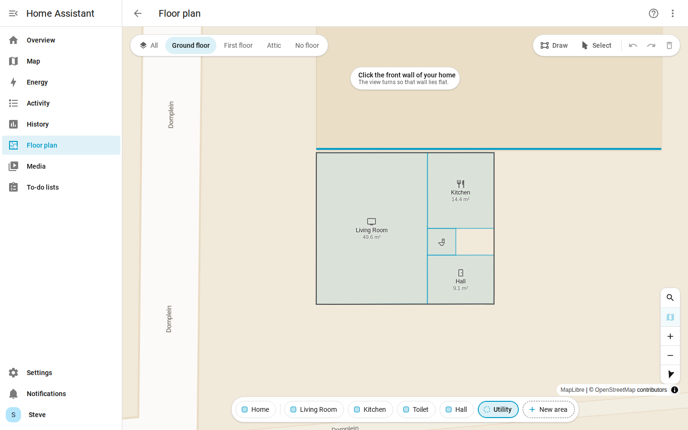
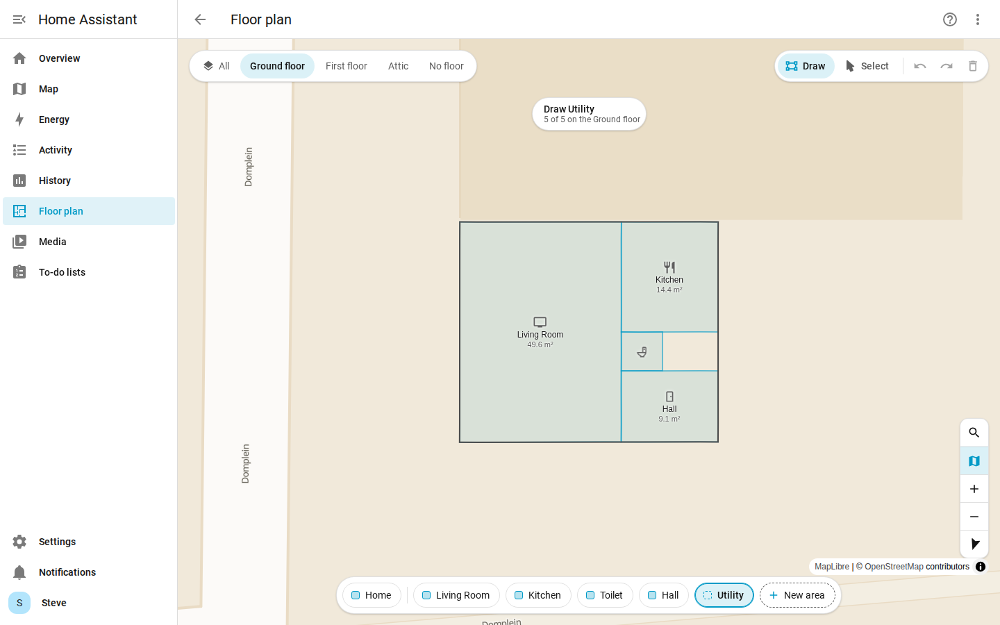
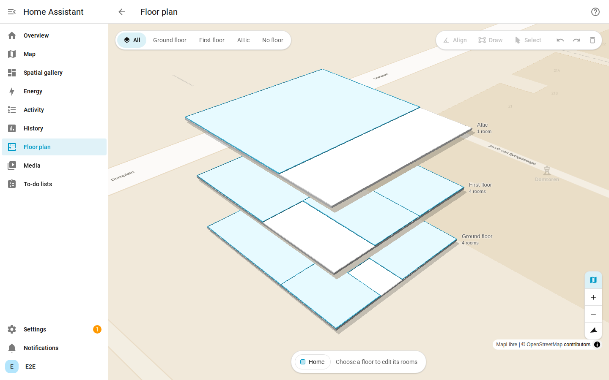
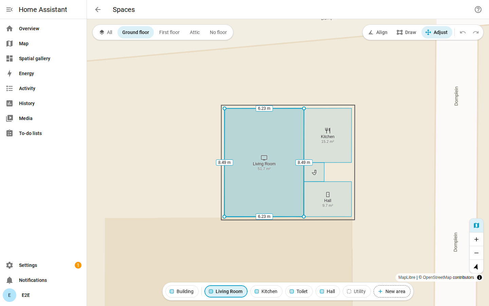
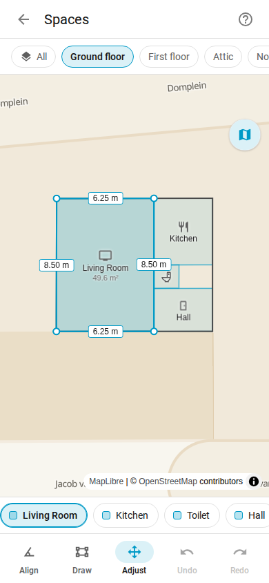
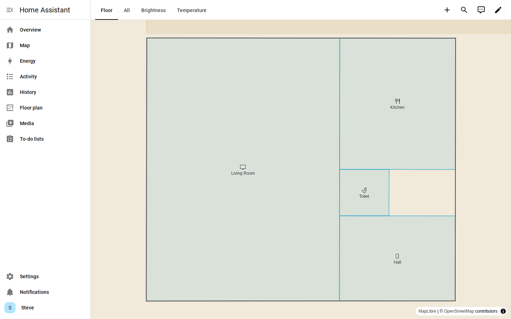

# User guide

Draw your house once, on Home Assistant's own map: the building outline, then each room as
boxes along one wall. Every action saves at once and can be undone.

## How it works

| Concept | What it is | Where it lives |
| --- | --- | --- |
| Floor | A Home Assistant floor; its level orders the floor buttons | Home Assistant's floor registry |
| Area | A Home Assistant area on a floor, with its name and icon; Spatial gives it an optional footprint | Home Assistant's area registry |
| Footprint | One polygon per area, drawn on the wall axes (the middle of each wall), so neighbouring rooms share edges | Spatial |
| Building | The outline on the axis of the exterior walls, one per installation; indoor rooms stay inside it. Its name is Home Assistant's location name | Spatial; the name from Home Assistant's core config |
| Site direction | The direction of one wall of your house; the map turns so that wall is horizontal, and boxes follow it | Spatial |
| Floor height | Elevation and height per floor, for tools and exports | Spatial |

- Home Assistant owns areas and floors: rename or move an area in Home Assistant and the map
  follows. The building carries Home Assistant's location name ("Home" unless you changed it).
- Spatial reads every corner on a lattice of 2.5 cm (1 in with US customary units) from the grid
  origin along the site direction, so shared walls and areas come out exact. What is stored and
  how it is measured is in the [integration README](../custom_components/spatial/README.md#data).

## First run

Press **Open floor plan** right after adding Spatial, or later choose **Floor plan** in the
sidebar or open Settings > Devices & services > Spatial > **Configure** and press **Open the
floor plan**. The editor is for administrators; other users do not see it. To hide it, edit the
sidebar in Home Assistant: long-press the title at the top of the sidebar and hide **Floor
plan**. The Configure form also holds **Address search server**: leave it at OpenStreetMap
unless you run your own Nominatim server or OpenStreetMap asks you to change it.

**One step at a time.** Until the plan is done, the panel opens on the floor where the next step
is, north up, centred on your home location, and the line at the top says only that step; the
one control it needs is lit with a ring. Nothing about the steps is stored: what is already
there is skipped, so a home on a building skips the search, a site with a direction skips
clicking your home and Align, a stored outline skips the outline, and leaving and coming back resumes at the first
unfinished step. Once every area has a shape, the panel opens on **All** and says nothing.

**Find your home.** When Home Assistant has no home location yet, or the map draws no building
there, the card **Find your home** opens (on the globe when there is no home location and
nothing is drawn). Type your street, house number and
town and press **Search** or Enter; Spatial asks OpenStreetMap only then, never while you type,
and does not keep what you typed. Pick one of up to five results, street on the first line and
town on the second (arrow keys move through them), and the map flies there and marks the place
with a pin until you click your house. A new search before Align drops a building you picked.
With no result,
check the spelling or add the town. When the search server cannot be reached, press **Retry**,
or close the card and pan the map to your home. The magnifier at the top of the map controls
(**Find an address**) opens the same card at any time.

**Click your home.** Before the site has a direction, the line at the top says "Click your
home": point at a building on the map, and the one under the pointer lights up; click it. A
click just beside a building, within a few pixels of its wall (a little more with a finger),
picks it too; a click inside a building always picks that one, so on a terrace the side of the
shared wall you click decides. A building cut by the map's tile edges is taken whole. Farther
away a click says "No building here". When the map is zoomed out too far to tell buildings
apart, the line says "Zoom in to your house." and a click zooms in on it. Nothing goes on until
you click, and nothing about the building is stored.

The building you picked shows dashed, and Align turns on at once (step 1 below). Wrong building?
Press **Pick another building** on the line at the top: Select is back on, the pick stays dashed
and **Align** is lit, and the next building you click replaces the pick.

The pointer shows what a click does: a hand over a building a click would pick, a crosshair in
Draw and Align, a move arrow over the selected shape in Select, a resize arrow on its sides, and
the map's open hand elsewhere, to pan.

**Home location.** Once you have aligned on your house (step 1 below), Home Assistant's toast
offers to make the middle of that building the home location Home Assistant uses for zones and
presence: **Use as home** when Home Assistant has no home location yet, or **Move** when it lies
more than 25 m from it, with the distance. The question stays until you answer it or close it
(not now), and you can go on meanwhile. Clicking another building before the outline is stored
asks again, for that building; a new question replaces an open one. A search result or a click
before Align asks nothing, as either often lands on the street or the house next door. Only the
latitude and longitude change; the toast **Home location moved** offers **Undo**. Within 25 m
nothing is asked. This needs an administrator, like the panel.

1. **Align.** Align is on after a pick, or press **Align**; the line says "Click the front wall
   of your home", with **Pick another building** after a pick. Click your
   house on the map near the wall the rooms follow; the wall under the pointer lights up. The
   map turns so that wall is horizontal, and Select is active again. The building you click
   here becomes the picked one, so clicking a wall of another building also corrects a wrong
   pick.
   From then on Align is no longer in the toolbar: to pick another wall, open the header's
   **More options** menu and choose **Change alignment**.

   

2. **Draw the building.** The strip at the bottom starts with the building, under Home
   Assistant's location name and highlighted while there is no outline. Without a building on
   the map, the line says "Draw the outline of your home" with **Draw** lit. When a building
   is picked, its own shape shows dashed, 150 mm inside the map's line (the map shows the outer
   face of the walls, the outline is their axis), with walls within 3 degrees of the site
   direction, or at most one unit of the map tiles (about 40 cm) across it, straightened onto it and diagonal walls kept. The line at the top asks "Use the
   map's outline?" with its size along the site direction, for example "9.80 × 7.60 m Or click
   another building.", or "9.80 × 7.60 m overall" for any shape but a rectangle. A part
   narrower than about 30 cm disappears when the shape moves inward; when that splits the
   building, the largest piece is offered. Only when nothing usable is left (a building under
   about 40 cm across, or a side shorter than 10 cm), nothing is offered and the line says
   "Draw the outline of your home ... Or click another building.". Until an outline is saved,
   the picked building stays as a thin line, buildings light up under the pointer, and a click
   picks another one, whose shape and size are then offered. In Draw that holds for a click
   inside another building, away from the picked one and before the first corner; any other
   click places a corner. The site direction stays; for a house
   at another angle use **Change alignment**.
   - **Use outline** saves that shape as the outline (Undo takes it back and asks again, with
     the same building picked) and makes it
     active in Select with its side lengths. The line then says "Check one length you know": on a
     rectangle, click the width or depth and type a length you have measured, for example the
     front of the house; any other shape shows the length of every side to compare with.
     **Looks right** moves on to the first room.
   - **Draw it myself** keeps Draw on, and the shape stays as a thin dotted line.

   Until an outline is saved, that dotted line shows whenever Draw is on, and the outline and
   the rooms snap to it after other rooms, lighting it up like any other wall. It never stops a
   move, as the map is only roughly right; once the outline is saved, the outline is the guide.

   To draw it, put it on the middle of the exterior walls, with the building on the map as a
   guide, and click each corner in turn; the line says "Click each corner; click the first
   corner to finish. Or click another building.". Each corner snaps like a box corner, also to
   the corners and sides placed so far, and a line runs from the last corner to the pointer.
   Clicking the first corner again (within the snap reach, where the ring under the pointer
   jumps onto it) saves the outline in one save and one undo step, and the next area is
   highlighted. Escape, Undo or Ctrl+Z takes back the last corner; Escape on the only corner
   ends the outline. An outline with fewer than three corners, a side shorter than one grid step
   or sides that cross is not saved: a toast gives the reason and the corners stay. Once the
   outline is saved, a box drawn with the building's pill against it joins it, as for rooms.
3. **Draw the rooms.** After an area's first shape, the next area of the floor without one is
   highlighted, and the line at the top says "Draw Kitchen" with how far the floor is, for
   example "3 of 5 on the Ground floor", and **Draw** lit while another tool is on. Draw each
   room on the wall axes, so neighbours share their edges and the outer rooms end on the
   outline. Use **New area** for a room that is not in Home Assistant yet. While you pick a room
   that has a shape to change it, the line stays empty.

   

4. **Next floor.** When every area of the floor has a shape, the line says "Ground floor done"
   with **Next floor** lit, which opens the next floor with an area to draw; the outline shows
   on every floor as a guide.
5. **All.** Press **All** to see the floors' rooms stacked above the outline, seen from the front corner of
   the house; the line says "Choose a floor to edit its rooms".

   

## The panel

The map fills the page under a header with Back (to Spatial's integration page), Help and the
**More options** menu. The floor buttons float top left, the tools top right, the map controls
bottom right and the area strip at the bottom.

### More options

| Entry | Does |
| --- | --- |
| Change alignment | Once the site has a direction: starts Align again, to turn the view to another wall. Off on All, like the tools |
| Clear *floor* | Removes every room shape on the floor in view at once, as one undo step, without asking; the building outline stays. The toast "*Floor* cleared" offers **Undo**, which takes back the clear only while nothing has changed since. Off on All, on No floor and on a floor without room shapes |
| Start over | Removes every room shape on every floor, the building outline, and the site's direction and grid origin at once, as one undo step, without asking, so the plan is back at picking your home's building. Home Assistant's areas, floors and home location stay. The toast "Started over" offers **Undo**, which brings everything back only while nothing has changed since. Off while there is no shape and no direction |

The menu closes with Escape or a click elsewhere.

### Floor buttons

| Button | Shows |
| --- | --- |
| All | Every floor's rooms, stacked with a gap between floors over the building outline on the ground and seen from the front corner of the house, each floor named right of its rooms with its number of rooms. Turn it with the right mouse button or two fingers; the compass returns to the view from the front corner. A view only: the tools, Undo and Redo are off, the strip shows only the Building pill, and the line at the top says "Choose a floor to edit its rooms" |
| A floor | That floor as a flat plan; every floor of Home Assistant is listed, ordered by level, also an empty one |
| No floor | Areas without a floor |

### Room labels

Each room on a floor shows its area's icon, name and net area, in m² or ft² as Home Assistant's
unit system says. A smaller room drops the area, then the name; pointing at it or tapping it shows the name. A tiny room has no label. The outline
shows the building's name until the floor has rooms.

### Tools

Exactly one tool is active; **Select** is the default. The tools work on a floor, not on All.

| Tool | Does |
| --- | --- |
| Align | In the toolbar until the first Align, then in the header menu as Change alignment. One click on a building on the map, near a wall, saves that wall's direction as the site direction. Without a building under the click a toast says "No building here"; when Spatial refuses the new direction, the toast gives its reason. On an empty plan, with no room and no outline drawn, it also puts the grid origin on the left end of that wall. The map stays on while Align is active |
| Draw | Draws boxes along the site direction (north up before any Align) for the highlighted pill; the building without an outline is drawn corner by corner instead. Corners snap to nearby room corners and walls on this floor and to the outline, else land on the 10 cm (4 in) grid; with Alt held they land on the 2.5 cm (1 in) lattice without snapping. While a side is shorter than one grid step only the start dot shows, and such a box is not drawn |
| Select | A tap on a room makes it active: it is filled, edged and gets round handles on its corners. Drag the active room to move it, or a side or corner of a rectangle to resize it. Type exact side lengths (below) |

### The area strip

| Pill | Means |
| --- | --- |
| Building | The outline, under Home Assistant's location name; always first |
| Filled square | The space has a shape |
| Dashed square | No shape yet |
| Highlighted | The active space: the next box goes to it, Select works on it |
| New area | Creates "Room 1" (the first free number) in Home Assistant at once, on this floor, highlights it in Draw and opens its name |

- The pills list the floor's areas in Home Assistant's order.
- Choosing a pill without a shape switches to Draw.
- Pointing at a pill outlines its room on the map, and pointing at a room marks its pill.
- Click the highlighted pill again (a long press on a phone) to rename the area in Home
  Assistant: Enter or the check saves, Escape cancels. Renaming the building renames the
  location in Home Assistant (Settings, System, General); only an administrator can do that.
- The arrow keys move between the pills.

### Draw

- **Draw a box:** press and drag from corner to corner, or click two corners (two taps on a
  phone). While drawing, the box shows its side lengths just outside its sides, and its area inside
  once the box is large enough on screen to hold it.
- **Join:** a box that touches the active space's shape joins it, so an L-shaped room is two
  boxes. A box apart from it is refused with the toast "A room is one shape: draw against it".
  After a space's first shape the next one is highlighted, so choose the space again before
  adding a box to it.
- **Snap:** each direction snaps on its own. Across and down, a corner within 8 px (12 px on a
  touch screen) of a room wall on this floor that runs along the site direction lands on that
  wall, and one near a room corner lines up with it; the outline comes after the rooms, the
  grid last. Near two walls that meet, it lands on both. What it snaps to lights up: a short
  thick line on the wall around the snapped point, a short line on both walls and a dot at a
  corner, else a dot on the corner it lines up with. The active shape's own walls never light
  up. Before the first corner, a small ring under the pointer shows where a click would put it,
  with what it snaps to lit up. So rooms drawn
  side by side share their wall and count as adjacent. Walls at other angles do not snap, their
  corners do.
- **Alt:** hold Alt to place without snapping, on the 2.5 cm (1 in) lattice. Phones always snap.
- **Move:** a drag that starts inside the active shape moves it; a click there still sets a
  corner. A moved shape snaps by its corners in the same way, else moves by whole grid steps;
  pushed into a corner it rests against both walls. Against the outline it stops where it first
  touches it, so a room inside stays inside and one outside stays outside. Against another room
  on this floor it stops where it first touches it too, so what is drawn keeps its space: sharing
  a wall or touching a corner is fine, overlapping is not. The stretch of each wall or the corner
  that stops it lights up; the rest of the drag still slides it along a wall that runs along the
  site direction. A room that already overlaps another moves freely past that one.
- **Pan:** hold Space and drag. **Escape** cancels a box, or takes back the last corner of an\n  outline being drawn. **Delete** removes the active shape.
- Draw turns the map back to the site direction and keeps it flat until another tool is picked.

### Select and side lengths



- Tap a room on the map, or its pill, to make it active. The **Building** pill makes the outline
  active.
- When the active room is a rectangle along the site direction, its width and depth each show
  once, on a button on one of the two sides they measure: on the side that is not a wall shared
  with another room, else on the bottom for the width and the left for the depth. The other two
  sides carry a small grip. Tap a length or a grip, type the length of that side and press Enter
  (at least 10 cm or 4 in; an unchanged length saves nothing). The length is rounded to the 2.5 cm (1 in) lattice, so 3.47 m becomes 3.475 m.
  The side's start corner stays, the opposite side follows. Escape closes the field.
- Moving a room snaps it to its neighbours as in Draw, else shifts it by whole grid steps, and
  stops it at the outline and at the other rooms on this floor as in Draw. Rooms do not stop the
  outline.
- **Stretch a side:** on such a rectangle, drag an edge anywhere along it. Only that edge moves,
  straight out or in, onto the 10 cm (4 in) grid, and rests on a parallel wall or a corner of
  another room or the outline nearby, which lights up. The length that changes counts on its
  button as it goes, and the draft shows its area when it is large enough on screen. An edge stops
  one grid step from the opposite one, at the outline (a room inside it stays inside, one outside
  stays outside) and where it would cover another room on this floor; the wall or corner it stops
  at lights up. While a side or corner is dragged, the room labels under it make way for the draft.
- **Drag a corner:** drag a corner of such a rectangle; the opposite corner stays. The corner
  snaps like a drawn box corner and lights up what it snaps to or stops at, both walls in a
  corner; each side stays at least one
  grid step. With Alt held an edge or corner lands on the 2.5 cm (1 in) lattice without
  snapping. The pointer turns into a resize arrow over an edge or a corner. **Escape** cancels;
  undo, redo and **Delete** do nothing while a side or corner is held.
- **The length or grip on a side is its handle:** drag it to stretch that side as above; the
  handle held turns the theme's primary colour. A click or tap without a drag opens the length
  field. On a touch screen, where the thin edge is hard to hit with a finger, a length also
  carries a grip mark, and every handle takes a fingertip-sized touch around it.
- A stretched side or dragged corner is one save and one undo step; one that ends where it
  started saves nothing.
- Lengths and areas follow Home Assistant's unit system and number format. Metric lengths show
  the stored value exactly, such as 3.40 m or 3.475 m. In US customary units a length shows as
  feet and inches, such as 11′ 4″, and is typed as 12' 6", 12 6, 150" or 12.5'.
- **Delete** and **Remove** remove the active shape here too.

### Undo, redo and saving

- **Undo** and **Redo** (Ctrl+Z, Ctrl+Shift+Z) step through every box, outline, move, resize and
  removal of this session, each as one save. While an outline's corners are being placed, Undo
  takes back the last corner instead.
- **Remove** (the bin after Redo) does what the Delete key does: it removes the active shape,
  the Building outline included, at once and as one undo step. It is off while the active space
  has no shape.
- Undo restores footprints only: an area created with New area stays in Home Assistant.
- Saving is silent. Refusals and failures use Home Assistant's toast. "Could not save" stays with
  **Retry**. A room that already had a shape keeps showing it as saved; a first box that failed
  stays on the map until it saves or the next box replaces it.
- Right after Home Assistant restarts, a save can come before Spatial has loaded; the toast then
  says "Spatial is still starting, try again in a moment", also with **Retry**.
- Spatial refuses an indoor room that would extend beyond the outline, or a shape with no net
  area left; in the panel that save ends as "Could not save".

### Help

The help button in the header opens a short sheet: the symbols (filled and dashed squares, the
corner handle, the look of a refused box), the keys, "Hold Alt to place without snapping" (not on
a touch screen), and a link to this documentation.

| Key | Does |
| --- | --- |
| Space + drag | Pan |
| Ctrl Z, Ctrl Shift Z | Undo, redo |
| Esc | Cancel the box, or a side or corner drag; take back the last outline corner |
| Delete | Remove the active shape |

### Map controls

| Control | Does |
| --- | --- |
| Find an address | Opens the address search card; picking a result flies the map there |
| Map | Shows or hides the map under the plan; off shows the plan on the page colour. Remembered in this browser |
| Zoom in, zoom out | Zooms the map |
| Compass | Turns with the map; a click turns back to the site direction ("Face the house"), or north up before any Align ("Face north") |

- The map is Home Assistant's own, light or dark with the theme, with tiles from Home Assistant;
  the plan takes its colours from the theme.
- Outside Draw, drag to pan; the map also rotates and tilts. In Draw, hold Space to pan.

### On a phone



At 600 px wide or less:

- The floors are a chip row under the header.
- The tools, Undo, Redo and Remove are a bar at the bottom, the strip just above it; after the
  first Align that is Draw, Select, Undo, Redo and Remove.
- Of the map controls only the round address search and map toggle stay; pinch to zoom and turn.
- The address search card spans the width under the header.
- Two taps draw a box; a long press on a pill renames it.

## Dashboard card



Add a card with `type: custom:spatial-map-card`, best in a view of type Panel, so the map fills
it; elsewhere the card is 400 px high. Everyone who can see the dashboard sees the map, also
users who are not an administrator. The card has no tools, and its labels
show icon and name without the area.

| `floor` | Shows |
| --- | --- |
| not set | Floor buttons for the floors with rooms; pan and zoom |
| `all` | All floors' rooms stacked from the front corner, fixed |
| a `floor_id` | That floor as a plan, fixed |

| `show_map` | Shows |
| --- | --- |
| not set | No map under all floors (`floor: all`); the map under one floor or the floor buttons |
| `true` | The map |
| `false` | The plan on the card's own background |

A fixed view has no buttons, frames the rooms' footprints and follows every change:

```yaml
type: panel
cards:
  - type: custom:spatial-map-card
    floor: ground_floor
```

## What Spatial computes

| Value | Where you see it |
| --- | --- |
| Net area: the footprint moved in by half a wall | Room labels in the panel; `area_m2` in the API |
| Neighbours: rooms sharing a wall axis | The API (`spatial/area/adjacent`) |
| On the facade: a room sharing the outline | The API (`on_facade`) |
| Outdoor: a room outside the outline | The API (`is_external`) |
| Room at a point | The API (`spatial/query_point`) |
| Stack: the floors in floor order, each room on every floor it occupies, the outline on the ground | All, and the card |

The sizes shown while drawing are previews; the saved net area comes from the integration. The
exact rules, and where they are approximate, are in the
[integration README](../custom_components/spatial/README.md#rules).

## Set through the API only

The panel does not edit these; tools and scripts set them through the
[websocket API](../custom_components/spatial/README.md#websocket-api), which also says what
each one means, and the [importer](../tools/README.md) sets floor heights.

| Setting | In the panel |
| --- | --- |
| Floor elevation and height (`spatial/floor/update`) | Not shown; the floors in All lie evenly apart in floor order |
| `floors_up` | The room counts on each of those floors for neighbours, and lies on each of those floors in All |
| `on_facade_override` | Not shown |
| Grid origin (the site's `origin`) | Where the 10 cm (4 in) drawing grid starts; only Align on an empty plan sets it from the panel |

## Known limits

- Boxes follow the site direction; walls at other angles cannot be drawn.
- Side lengths can only be typed, and sides and corners only dragged, for a rectangle along the
  site direction. A change arriving from elsewhere while a side field is open resets the field.
- A moved room, dragged side or corner cannot take space from another room; shrink that room
  first. A moved room travels in a straight line from where it was picked up, so a drag around a
  corner of the outline or of a room stops at that corner.
- Snapping uses the rooms on this floor and the outline: not the floor below, diagonal walls or
  buildings on the map, except the map's dashed outline while the building has no outline. A moved room lines up its corners with others, not its walls with their
  corners.
- After the first room or the outline, a new Align keeps the grid origin, so the grid turns
  around the old origin.
- Align needs a building in the map tiles. A building cut by a tile border gives only the part
  in that tile.
- The map's outline follows the map's shape: a wall more than 3 degrees off the site direction
  and more than about 40 cm across it (one unit of the map tiles) stays slanted, a step in a wall under one grid step (10 cm, 4 in) is straightened away, and a
  house the map joins to its neighbours is offered with them. On any shape
  but a rectangle its side lengths only show, they cannot be typed. It is offered for the building picked in this visit, else, after leaving and coming back, for
  the building the map shows at the grid origin, which Align on an empty plan puts on the
  clicked wall; with the map hidden it is not offered. The map's buildings are about 0.4 m accurate, so check one length.
- Undo covers this session only, and overwrites changes made elsewhere in the meantime. An undo
  for an area deleted in Home Assistant keeps failing; reload the panel to clear the history.
- The floors in All lie evenly apart in floor order, whatever elevation a floor has.
- A search result shows the house number after the street, also where addresses are written the
  other way round, and its second line may start with a neighbourhood rather than the town.
