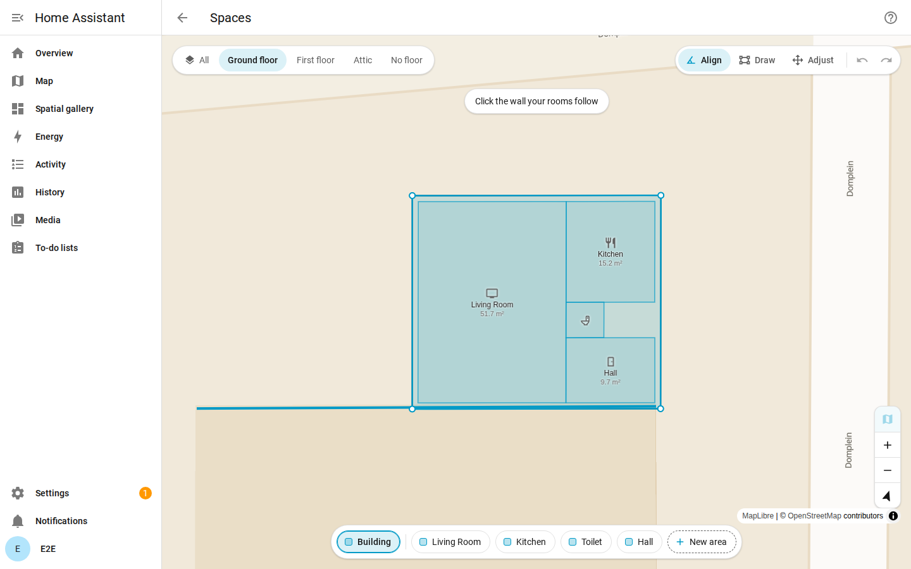
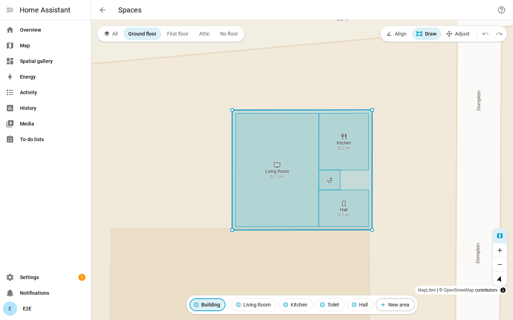
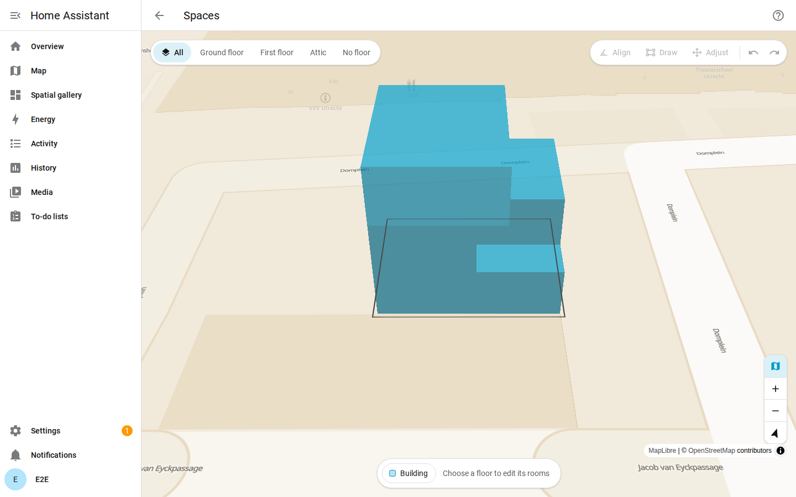
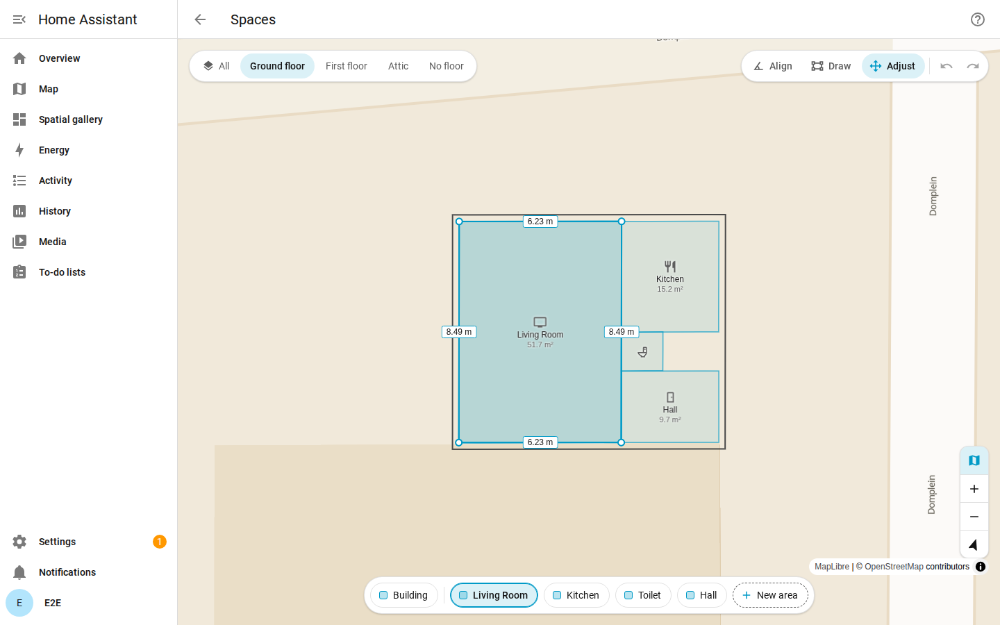
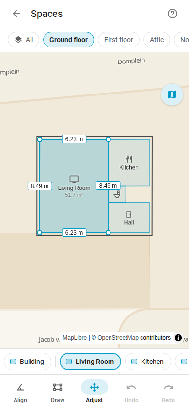
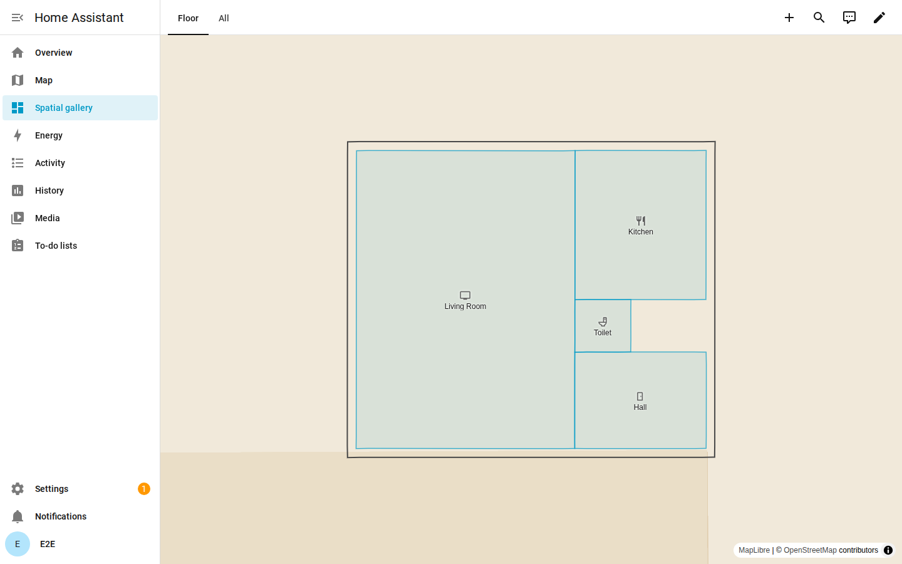

# User guide

Draw your house once, on Home Assistant's own map: the building outline, then each room as
boxes along one wall. Every action saves at once and can be undone.

## How it works

| Concept | What it is | Where it lives |
| --- | --- | --- |
| Floor | A Home Assistant floor; its level orders the floor buttons | Home Assistant's floor registry |
| Area | A Home Assistant area on a floor, with its name and icon; Spatial gives it an optional footprint | Home Assistant's area registry |
| Footprint | One polygon per area, drawn to the wall centrelines, so neighbouring rooms share edges | Spatial |
| Building | The outline of the facade, one per installation | Spatial |
| Site direction | The direction of one wall of your house; the map turns so that wall is horizontal, and boxes follow it | Spatial |
| Floor height | Elevation and height per floor, for the 3D view; without them floors stack 3 m per level | Spatial |

- Home Assistant owns areas and floors. Names, icons, levels and floor assignment are always
  read from its registries; rename or move an area in Home Assistant and the map follows.
- Deleting an area or floor in Home Assistant deletes its footprint or heights.
- Spatial stores coordinates in WGS84, the same world as Home Assistant's zones.

## First run

Press **Open Spaces** right after adding Spatial, or later open Settings > Devices & services >
Spatial > **Configure**; the editor has no sidebar entry and is for administrators. The panel
opens on **All**, north up, centred on your home location.

1. **Align.** Pick a floor, press **Align** and click your house on the map near the wall the
   rooms follow; the line at the top says "Click the wall your rooms follow" and the wall under
   the pointer lights up. The map turns so that wall is horizontal, and Adjust is active again.

   

2. **Draw the building.** Press **Draw**. The strip at the bottom starts with **Building**,
   highlighted while there is no outline. Draw the facade as the map shows it: press and drag
   from one corner to the opposite one, or click one corner and then the other. Add boxes
   against it for an L or other shape.
3. **Draw the rooms.** After an area's first shape, the next area of the floor without one is
   highlighted, and the line at the top says "Draw Kitchen" with how far the floor is, for
   example "3 of 5". Draw each room to the wall centrelines, so neighbours share their edges.
   Use **New area** for a room that is not in Home Assistant yet.

   

4. **Next floor.** Press the next floor button and draw its rooms; the outline shows on every
   floor as a guide.
5. **All.** Press **All** to see the floors stacked in 3D.

   

## The panel

The map fills the page under a header with Back (to Spatial's integration page) and Help. The
floor buttons float top left, the tools top right, the map controls bottom right and the area
strip at the bottom.

### Floor buttons

| Button | Shows |
| --- | --- |
| All | Every floor stacked in 3D. A view only: the tools, Undo and Redo are off, and the strip shows the Building pill with "Choose a floor to edit its rooms" |
| A floor | That floor as a flat plan; every floor of Home Assistant is listed, ordered by level, also an empty one |
| No floor | Areas without a floor |

### Room labels

Each room on a floor shows its area's icon, name and net m². A smaller room drops the m², then
the name; pointing at it or tapping it shows the name. A tiny room has no label. The outline
shows "Building" until the floor has rooms.

### Tools

Exactly one tool is active; **Adjust** is the default. The tools work on a floor, not on All.

| Tool | Does |
| --- | --- |
| Align | One click on a building on the map, near a wall, saves that wall's direction as the site direction. Without a building under the click a toast says "No building here". The map stays on while Align is active |
| Draw | Draws boxes along the site direction (north up before any Align) for the highlighted pill |
| Adjust | A tap on a room makes it active: it is filled, edged and gets round handles on its corners. Drag the active room to move it. Type exact side lengths (below) |

### The area strip

| Pill | Means |
| --- | --- |
| Building | The outline; always first |
| Filled square | The space has a shape |
| Dashed square | No shape yet |
| Highlighted | The active space: the next box goes to it, Adjust works on it |
| New area | Creates "Room 1" (the first free number) in Home Assistant at once, on this floor, highlights it in Draw and opens its name |

- The pills list the floor's areas in Home Assistant's order.
- Choosing a pill without a shape switches to Draw.
- Pointing at a pill outlines its room on the map, and pointing at a room marks its pill.
- Click the highlighted pill again (a long press on a phone) to rename the area in Home
  Assistant: Enter or the check saves, Escape cancels.
- The arrow keys move between the pills.

### Draw

- **Draw a box:** press and drag from corner to corner, or click two corners (two taps on a
  phone). While drawing, the box shows its side lengths and area.
- **Join:** a box that touches the active space's shape joins it, so an L-shaped room is two
  boxes. A box apart from it is refused with the toast "A room is one shape: draw against it".
- **Move:** a drag that starts inside the active shape moves it; a click there still sets a
  corner.
- **Pan:** hold Space and drag. **Escape** cancels a box. **Delete** removes the active shape.
- Draw turns the map back to the site direction and keeps it flat until another tool is picked.

### Adjust and side lengths



- Tap a room on the map, or its pill, to make it active. The **Building** pill makes the outline
  active.
- When the active room is a rectangle along the site direction, each side shows its length as a
  button. Tap one, type the length in metres and press Enter (at least 0.20 m). The side's start
  corner stays, the opposite side follows. Escape closes the field.
- **Delete** removes the active shape here too.

### Undo, redo and saving

- **Undo** and **Redo** (Ctrl+Z, Ctrl+Shift+Z) step through every box, move, resize and removal
  of this session, each as one save.
- Undo restores footprints only: an area created with New area stays in Home Assistant.
- Saving is silent. Refusals and failures use Home Assistant's toast. "Could not save" stays with
  **Retry**, and the shape that failed stays on the map until it saves or the next box replaces
  it.

### Help

The help button in the header opens a short sheet: the symbols (filled and dashed squares, the
corner handle, the look of a refused box), the keys, and a link to this documentation.

| Key | Does |
| --- | --- |
| Space + drag | Pan |
| Ctrl Z, Ctrl Shift Z | Undo, redo |
| Esc | Cancel the box |
| Delete | Remove the active shape |

### Map controls

| Control | Does |
| --- | --- |
| Map | Shows or hides the map under the plan; off shows the plan on the page colour. Remembered in this browser |
| Zoom in, zoom out | Zooms the map |
| Compass | Turns with the map; a click turns back to the site direction ("Face the house"), or north up before any Align ("Face north") |

- The map is Home Assistant's own, light or dark with the theme, with tiles from Home Assistant;
  the plan takes its colours from the theme.
- Outside Draw, drag to pan; the map also rotates and tilts. In Draw, hold Space to pan.

### On a phone



At 600 px wide or less:

- The floors are a chip row under the header.
- The tools, Undo and Redo are a bar at the bottom, the strip just above it.
- Of the map controls only the round map toggle stays; pinch to zoom and turn.
- Two taps draw a box; a long press on a pill renames it.

## Dashboard card



Add a card with `type: custom:spatial-map-card`, best in a view of type Panel, so the map fills
it; elsewhere the card is 400 px high. Everyone who can see the dashboard sees the map, also
users who are not an administrator. The card has no tools, always shows the map, and its labels
show icon and name without m².

| `floor` | Shows |
| --- | --- |
| not set | Floor buttons for the floors with rooms; pan, zoom and rotate |
| `all` | All floors in 3D, fixed |
| a `floor_id` | That floor as a plan, fixed |

A fixed view has no buttons, frames the rooms' footprints and follows every change:

```yaml
type: panel
cards:
  - type: custom:spatial-map-card
    floor: ground_floor
```

## What Spatial computes

| Value | How | Where you see it |
| --- | --- | --- |
| Net area | The footprint shrunk by 50 mm on every side, in m², on a local tangent plane with exact WGS84 radii | Room labels in the panel; `area_m2` in the API |
| Neighbours | Rooms whose edges coincide within 0.05 m over at least 0.3 m, on every floor both occupy | The API (`spatial/area/adjacent`) |
| On the facade | A room with an edge on the building outline, unless overridden | The API (`on_facade`) |
| Outdoor | More than half of the room lies outside the building outline | The API (`is_external`) |
| Room at a point | The smallest footprint containing it | The API (`spatial/query_point`) |
| 3D | Base of each room's floor up to the top of the highest floor it occupies | All, and the card |

The sizes shown while drawing are previews; the saved net area comes from the integration.

## Set through the API only

The panel does not edit these; tools and scripts set them through the
[websocket API](../custom_components/spatial/README.md#websocket-api), and the
[importer](../tools/README.md) sets floor heights.

| Setting | Effect |
| --- | --- |
| Floor elevation and height | Where each floor sits in 3D (`spatial/floor/update`) |
| `floors_up` | A room that reaches the floors above its own, such as a stairwell or a double-height living room; it then counts on each of those floors for neighbours and the 3D view |
| `on_facade_override` | Replaces the derived `on_facade` with true or false |
| Grid origin | The site's `origin`, a point the 10 cm drawing grid runs from along the site direction; stored; the panel does not snap to it |

## Known limits

- Boxes follow the site direction; walls at other angles cannot be drawn.
- Side lengths can only be typed for a rectangle along the site direction.
- Lengths shown in the panel are measured on a sphere and can differ from the drawn size by
  about 0.3%; the 8.5 m side of the example living room shows as 8.49 m.
- Align needs a building in the map tiles. A building cut by a tile border gives only the part
  in that tile.
- Undo covers this session only, and overwrites changes made elsewhere in the meantime. An undo
  for an area deleted in Home Assistant keeps failing; reload the panel to clear the history.
- A fixed card frames the footprints, so tall floors in its 3D view can reach past the frame.
- The net area is exact for right angles.
