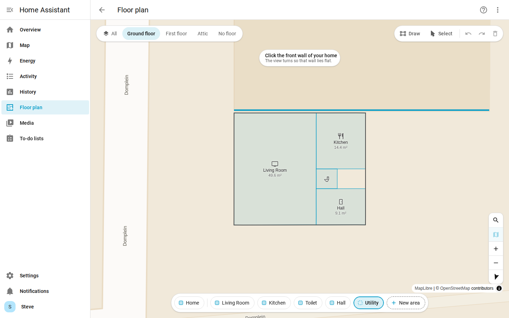
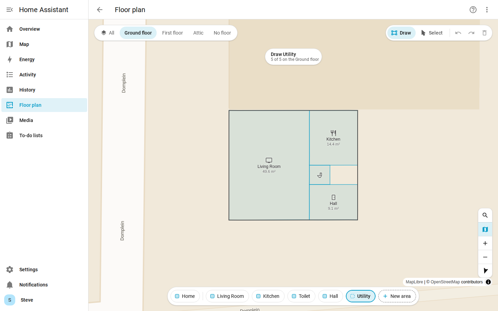
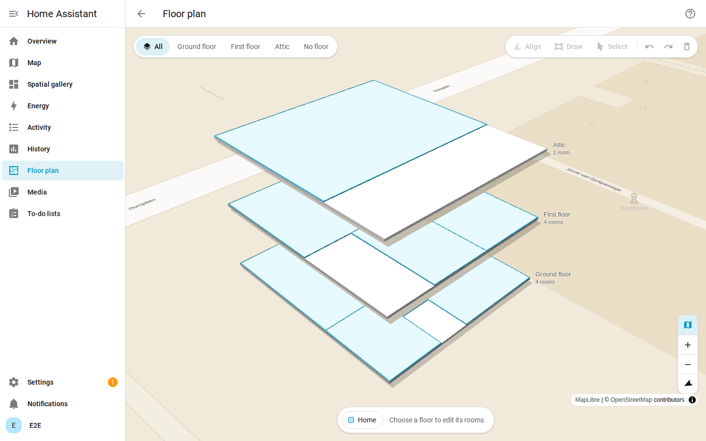
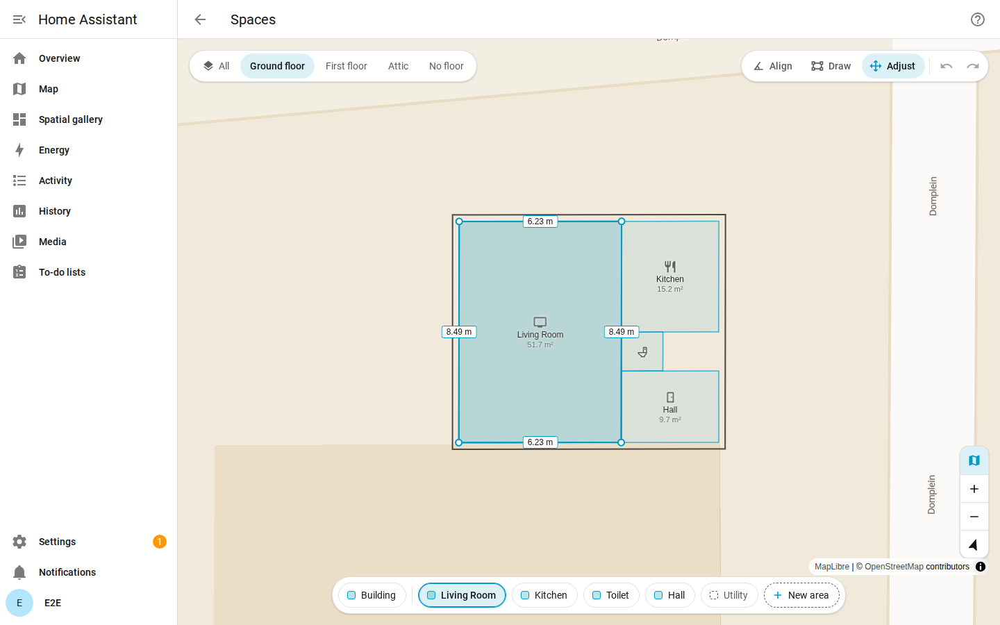
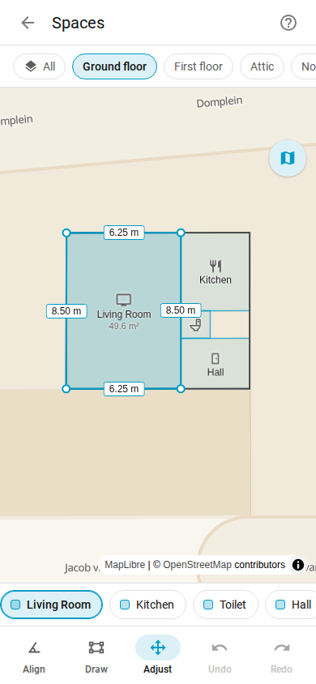
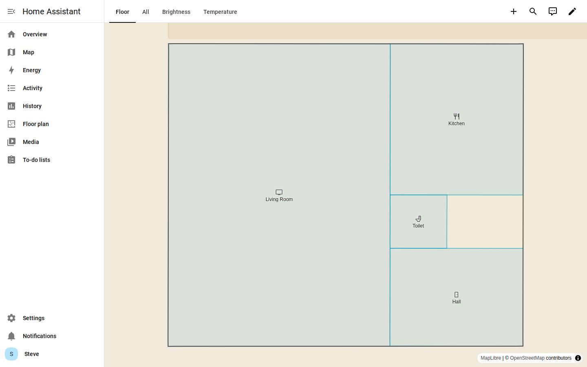

# User guide

Draw your house once, on Home Assistant's own map: the building outline, then each room as
boxes along one wall. Every action saves at once and can be undone.

Needs an administrator account and Spatial installed (see the [README](../README.md#install)).

## How it works

| Concept | What it is |
| --- | --- |
| Floor | A Home Assistant floor; its level orders the floor buttons |
| Area | A Home Assistant area on a floor, with its name and icon; Spatial gives it an optional footprint |
| Footprint | One polygon per area, drawn on the wall axes (the middle of each wall), so neighbouring rooms share edges |
| Building | The outline on the axis of the exterior walls, one per installation; indoor rooms stay inside it. Its name is Home Assistant's location name |
| Site direction | The direction of one wall of your house; the map turns so that wall is horizontal, and boxes follow it |

## First run

Create floors and put areas on them first (Settings > Areas, labels & zones); areas without a
floor land under No floor. Open **Floor plan** from the sidebar (admins only; hide it by
long-pressing the sidebar title). The line at the top names the next step and lights the button
to press; finished steps are skipped and leaving resumes at the first unfinished one. The
Configure form also holds **Address search server**: leave it at OpenStreetMap unless you run
your own Nominatim server or OpenStreetMap asks you to change it.

**Find your home.** Type street, number and town, press **Search** or Enter. Pick a result (up
to five). No result: check spelling. Server unreachable: **Retry**. The magnifier on the map
controls reopens the card. What is sent: [README](../README.md#privacy).

**Click your home.** Click the building. A click inside a building picks it; on a terrace the
side of the shared wall decides. Wrong one: **Pick another building**. On a phone, tap.

**Home location.** After Align, a toast offers to move Home Assistant's home location to the
middle of the building (**Use as home** / **Move**, only beyond 25 m). Only latitude and
longitude change; **Undo** is offered. Needs an administrator.

1. **Align.** Press **Align** and click the wall the rooms follow; the map turns so it is
   horizontal. Later: More options > **Change alignment**.

   

2. **Draw the building.** Use the map's outline (**Use outline**, dashed, offset to the wall
   axis) or **Draw it myself** (click each corner, click the first to close). Then check one
   length you know and press **Looks right**. Escape or Undo takes back the last corner.
3. **Draw the rooms.** Draw each room on the wall axes so neighbours share edges. Use **New
   area** for a room that is not in Home Assistant yet.

   

4. **Next floor** opens the next floor with an area to draw.
5. **All** shows the floors stacked over the outline.

   

## The panel

The map fills the page under a header with Back (to Spatial's integration page), Help and the
**More options** menu. The floor buttons float top left, the tools top right, the map controls
bottom right and the area strip at the bottom.

### More options

| Entry | Does |
| --- | --- |
| Change alignment | Starts Align again, to turn the view to another wall |
| Clear *floor* | Removes every room on this floor, one undo step, no confirmation; the outline stays |
| Start over | Removes all rooms, the outline, the site direction and grid origin; no confirmation. Areas, floors and home location stay |

### Floor buttons

| Button | Shows |
| --- | --- |
| All | Every floor stacked over the outline, seen from the front corner; view only |
| A floor | That floor's plan |
| No floor | Areas without a floor |

### Room labels

Each room on a floor shows its area's icon, name and net area, in m² or ft² as Home Assistant's
unit system says. A smaller room drops the area, then the name; a tiny room shows its name while pointed at, for 2 s after a tap, or while it is active. The outline
shows the building's name until the floor has rooms.

### Tools

Only the current tool is filled. Before you pick your home none is current; the guide then makes
Align current, and Draw when it asks you to draw. A finished floor leaves nothing selected. The
tools work on a floor, not on All.

| Tool | Does |
| --- | --- |
| Align | Click a building near a wall to save its direction as the site direction. On an empty plan it also puts the grid origin on the left end of that wall |
| Draw | Drag a box along the site direction; corners snap to walls and corners, else to a 10 cm (4 in) grid; hold Alt for 2.5 cm (1 in) without snapping |
| Select | A tap on a room makes it active: it is filled, edged and gets round handles on its corners. Drag the active room to move it, or a side or corner of a rectangle, or of the building outline in any shape, to resize it. Type exact side lengths of a rectangle (below) |

### The area strip

| Pill | Means |
| --- | --- |
| Building | The outline, under Home Assistant's location name; always first |
| Filled square | The space has a shape |
| Dashed square | No shape yet |
| Highlighted | The active space: the next box goes to it, Select works on it |
| New area | Creates "Room 1" (the first free number) in Home Assistant at once, on this floor, highlights it in Draw and opens its name |

Click the highlighted pill again to rename the area (the Building pill renames the Home
Assistant location, admins only).

### Draw

- **Draw a box:** drag or click two corners (two taps on a phone).
- **Join:** a box that touches the active space's shape joins it, so an L-shaped room is two
  boxes. A box apart from it is refused: "A room is one shape: draw against it".
- **Snap:** walls and corners nearby, then the map building, then the grid; lit in the accent
  colour. Hold Alt to place without snapping; phones always snap.
- **Move:** drag inside the active shape. It stops against the outline and other rooms, never
  overlaps.
- **Pan:** hold Space and drag.
- **Escape** cancels a box; **Delete** removes the active shape.

### Select and side lengths

- Tap a room or its pill to make it active.
- Drag it to move it. Drag a side or corner of a rectangle to resize it.
- Click a length and type a new one (at least 10 cm or 4 in, rounded to the 2.5 cm (1 in)
  lattice).
- Drag the corners and sides of the outline, of any shape, to correct it. A shape that would
  cross itself shows in the warning colour and a toast gives the reason; Spatial refuses an
  outline that would leave a room outside it.
- In US customary units a length is typed as 12' 6", 12 6, 150" or 12.5'.
- **Delete** and **Remove** remove the active shape here too.

### Undo, redo and saving

- **Undo** and **Redo** (Ctrl+Z, Ctrl+Shift+Z) cover this session.
- **Remove** is the Delete key.
- Undo restores footprints only: an area created with New area stays in Home Assistant.
- Saving is silent. A failure shows a toast with **Retry**. A save Spatial refuses says why
  (outline, too small, area removed).

### Keys

| Key | Does |
| --- | --- |
| Space + drag | Pan |
| Ctrl Z, Ctrl Shift Z | Undo, redo |
| Esc | Cancel the box, or a side or corner drag; take back the last outline corner |
| Delete | Remove the active shape |

### Map controls

| Control | Does |
| --- | --- |
| Find an address | Opens the address search card; picking a result flies the map there |
| Map | Shows or hides the map under the plan; off shows the plan on the page colour. Remembered in this browser |
| Zoom in, zoom out | Zooms the map |
| Compass | Turns with the map; a click turns back to the site direction ("Face the house"), or north up before any Align ("Face north") |

- The map is Home Assistant's own, light or dark with the theme, with tiles from Home Assistant;
  the plan takes its colours from the theme.
- Outside Draw, drag to pan; the map also rotates and tilts. In Draw, hold Space to pan.

### On a phone

- The floors are a chip row under the header.
- The tools, Undo, Redo and Remove are a bar at the bottom.
- Two taps draw a box; a long press on a pill renames it.
- Pinch to zoom and turn.

## Dashboard card

Add `custom:spatial-map-card`, best in a Panel view. Everyone who can see the dashboard sees the
map; there are no tools.

| `floor` | Shows |
| --- | --- |
| not set | Floor buttons for the floors with rooms; pan and zoom |
| `all` | All floors' rooms stacked from the front corner, fixed, every floor at the same scale like an axonometric drawing; a floor without rooms shows "<floor> · not drawn" with a dashed outline |
| a `floor_id` | That floor as a plan, fixed |

| `show_map` | Shows |
| --- | --- |
| not set | No map under all floors (`floor: all`); the map under one floor or the floor buttons |
| `true` | The map |
| `false` | The plan on the card's own background |

| `colour_by` | Colours each room of a card fixed to one floor, and writes the value under its name |
| --- | --- |
| not set | The rooms as they are |
| `brightness` | The brightest `light` of the area that is on, 0 to 100 %, in Home Assistant's light colour (`Off` and no colour when none is on) |
| `temperature` | The temperature sensor chosen for the area in Home Assistant, else the average of the area's `sensor` entities with device class temperature, on a scale from cool at 15 °C through a neutral grey at 21 °C to heat at 28 °C (shown to one decimal in the sensor's own unit) |

An entity belongs to the area it is set to, else to the area of its device. Unavailable and
unknown states are left out. The all-floors view and the panel ignore `colour_by`. The card
editor offers `colour_by`; the other options are set in YAML.

## What Spatial computes

| Value | Where you see it |
| --- | --- |
| Net area: the footprint moved in by half a wall | Room labels in the panel; `area_m2` in the API |
| Neighbours: rooms sharing a wall axis | The API (`spatial/area/adjacent`) |
| On the facade: a room sharing the outline | The API (`on_facade`) |
| Outdoor: a room outside the outline | The API (`is_external`) |
| Room at a point | The API (`spatial/query_point`) |
| Stack: the floors in floor order, each room on every floor it occupies, the outline on the ground | All, and the card |

The sizes shown while drawing are previews.

## Set through the API only

The panel does not edit these; tools and scripts set them through the
[websocket API](../custom_components/spatial/README.md#websocket-api), and the
[importer](../tools/README.md) sets floor heights.

- Floor elevation and height (`spatial/floor/update`)
- `floors_up`
- `on_facade_override`
- Grid origin (the site's `origin`): only Align on an empty plan sets it from the panel

## Known limits

- Boxes follow the site direction; walls at other angles cannot be drawn.
- Side lengths can only be typed for a rectangle along the site direction.
- A moved room, dragged side or corner cannot take space from another room; shrink that room
  first.
- After the first room or the outline, a new Align keeps the grid origin, so the grid turns
  around the old origin.
- Align needs a building in the map tiles.
- The map's buildings are about 0.4 m accurate, so check one length. The map outline is
  straightened and small steps under 0.5 m are merged; draw them back if they matter.
- Undo covers this browser session only, and overwrites changes made elsewhere in the meantime.
- After a reload, Clear floor and Start over can no longer be undone either. Restore a Home
  Assistant backup instead: `.storage/spatial` is in every backup.
- The floors in All lie evenly apart in floor order, whatever elevation a floor has.
